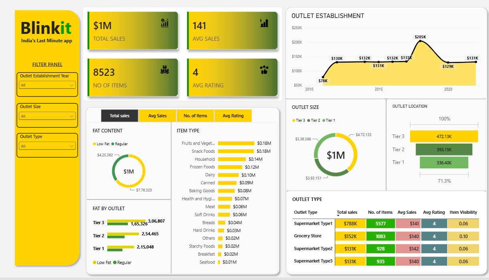

# Blinkit Sales Analysis Dashboard | Power BI

## Project Overview

This project analyzes Blinkit's sales performance using an interactive Power BI dashboard. It explores item categories, fat content, outlet characteristics, and key performance indicators.

This is a learning and portfolio project built using a provided dataset. It is not an official Blinkit report.

## Key Performance Indicators

- **Total Sales:** Overall revenue generated from items sold.
- **Average Sales:** Average sales value.
- **Number of Items:** Total items sold.
- **Average Rating:** Average customer rating.

## Business Questions

1. How do total sales vary by fat content?
2. Which item types generate the highest sales?
3. How do sales by fat content compare across outlets?
4. How do sales vary by outlet establishment year?
5. How are sales distributed across outlet sizes?
6. How do sales vary across outlet locations?
7. How do total sales, average sales, number of items, and average rating compare across outlet types?

## Dashboard Preview

## Tools Used

- Power BI Desktop
- Microsoft Excel
- Power Query and DAX, where used in the report

## Interactive Features

The dashboard includes filters for outlet establishment year, outlet size, and outlet type.

## Project Files

- **Power BI Report:** [Blinkit.pbix](Blinkit.pbix)
- **Excel Dataset:** [BlinkIT Grocery Data.xlsx](%22BlinkIT%20Grocery%20Data.xlsx%22)
- **Dashboard Preview:** [dashboard.png](dashboard.png)

## How to View the Project

1. Download `Blinkit.pbix` from this repository.
2. Open it using Power BI Desktop.
3. If prompted, update the Excel source path to the downloaded dataset.
4. Refresh the data if required.

## How to View

1. Download the Power BI report.
2. Open it in Power BI Desktop.
3. If needed, update the Excel source path and refresh the data.

## Disclaimer

This project was created for learning and portfolio purposes using a provided dataset. The analysis should not be interpreted as an official report from Blinkit.
